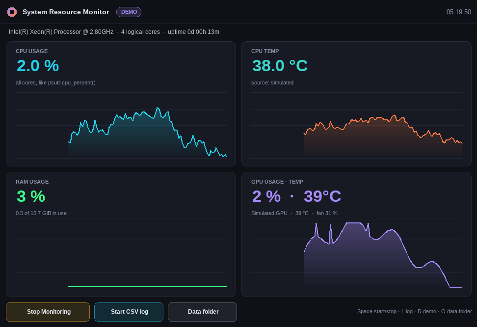
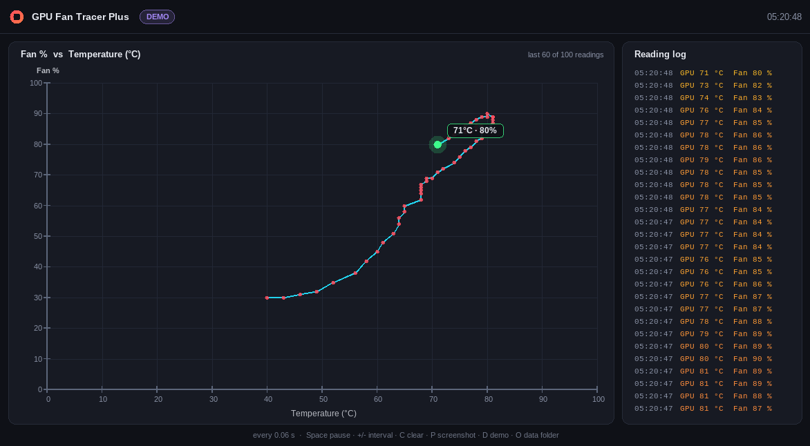
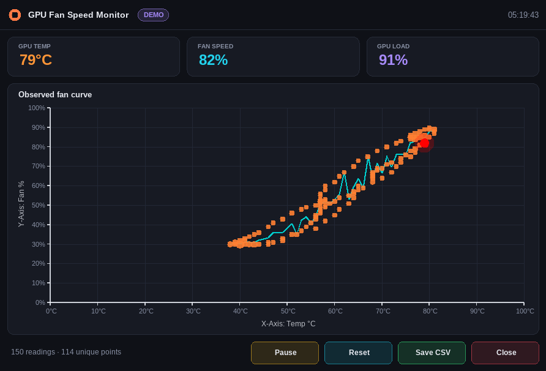

# Afterburner Suite

Five standalone Windows monitoring apps for NVIDIA GPUs and your system. They're built from the
`GPUFANHEATDIAGRAMM*` C++ prototypes and the two Kivy Python scripts (originals kept in `legacy/`).
Each app has its **own unique identity**, so you can install, run, update and uninstall all of them
**side by side**.

| App | Built from | Download |
|---|---|---|
| **GPU Fan Curve Monitor**: the full dashboard (fan curve, learned curve, timeline, multi-GPU, alerts, logging) | all 5 `GPUFANHEATDIAGRAMM*.cpp` | [`exe`](dist/GPUFanCurveMonitor.exe) · [`setup`](dist/GPUFanCurveMonitor-Setup.exe) |
| **GPU Fan Tracer**: the classic fan-vs-temp trace of the last 100 readings | `GPUFANHEATDIAGRAMMTRACER.cpp` | [`exe`](dist/GPUFanTracer.exe) · [`setup`](dist/GPUFanTracer-Setup.exe) |
| **GPU Fan Tracer Plus**: the trace plus red history dots and a reading log | `GPUFANHEATDIAGRAMMTRACERMORE2.cpp` | [`exe`](dist/GPUFanTracerPlus.exe) · [`setup`](dist/GPUFanTracerPlus-Setup.exe) |
| **GPU Fan Speed Monitor**: the observed fan curve, with Pause, Reset, Save CSV and Close buttons | `GPUFANSPEEDMONITOR.py` | [`exe`](dist/GPUFanSpeedMonitor.exe) · [`setup`](dist/GPUFanSpeedMonitor-Setup.exe) |
| **System Resource Monitor**: CPU usage and temperature, RAM, and GPU usage, temperature and fan, with sparklines | `CPUFANSPEEDMONITOR.py` | [`exe`](dist/SystemResourceMonitor.exe) · [`setup`](dist/SystemResourceMonitor-Setup.exe) |

All apps are native 64-bit Win32 + GDI+ programs and statically linked. They don't need Python, Kivy, psutil,
the `wmi` package or GTK. GPU data comes from `nvidia-smi`, which runs hidden on a background thread.
Every app has a **demo mode** (`D` key or `--demo`) for PCs without an NVIDIA card.

<p>
 
 
</p>

## Parallel installation: unique identity per app

Every app has its own value for each of the following, so no two apps share anything:

| | Example (GPU Fan Tracer) |
|---|---|
| AppUserModelID (taskbar grouping, pinning, jump lists) | `CoolCupMan.Afterburner.GPUFanTracer` |
| Installer AppId / uninstall registry key | `{5ad65994-25cf-428d-9f77-6f7ab2bd7e41}` |
| Install folder | `C:\Program Files\Afterburner\GPU Fan Tracer\` |
| Start-menu shortcut (stamped with the AppUserModelID) | `Afterburner\GPU Fan Tracer.lnk` |
| Window class and single-instance mutex | `Afterburner.GPUFanTracer.Wnd`, `Local\CoolCupMan.Afterburner.GPUFanTracer` |
| Settings, logs and screenshots | `%LOCALAPPDATA%\Afterburner\GPUFanTracer\` |
| Manifest identity, version info and icon colour | `CoolCupMan.Afterburner.GPUFanTracer`, plus a sky-blue icon |

All the identities are listed in [`apps.txt`](apps.txt). `build.sh` refuses to build if a source file
doesn't declare the AppUserModelID listed there.

- **Installers** (`*-Setup.exe`, 64-bit NSIS): each app installs to its own folder and has its own entry in
  *Apps & features*. Shortcuts are created for all users. They support silent install (`/S`, plus `/D=C:\path` for a custom
  folder) and uninstalling one app leaves the others untouched. An optional desktop shortcut is offered, and your
  settings are kept on uninstall.
- **Portable use:** if you run an `.exe` from a writable folder, it keeps its `.ini`, logs and screenshots next to itself.
  Installed copies use `%LOCALAPPDATA%` instead. To force portable mode, put an empty `portable.txt` beside the exe.
- **One instance per app:** starting an app twice brings the open window to the front. Different apps run
  together freely. To start a second copy anyway, use `--new-instance`.

Tested under Wine: the five installers were installed silently side by side and the five apps ran together. A
second launch of one app focused the existing window, and uninstalling one app removed only its own files and registry key.
Wine doesn't save shortcut properties, so stamping the AppUserModelID into the shortcuts could only be checked on real Windows.

## Shortcuts

| Key | Fan Curve Monitor | Tracer / Tracer Plus | Fan Speed Monitor | System Resource Monitor |
|---|---|---|---|---|
| `Space` | pause | pause | pause | start/stop |
| `D` | demo mode | demo mode | demo mode | demo mode |
| `O` | data folder | data folder | data folder | data folder |
| other | `Tab` GPU · `+/-` interval · `↑/↓` alert · `L` log · `S` CSV · `P` PNG · `Ctrl+C` copy · `T` on top · `H` help | `+/-` interval · `C` clear · `P` PNG | `R` reset · `S` CSV + PNG · `Esc` close | `L` CSV log |

The command line options are the same for every app: `--demo`, `--interval <ms>`, `--new-instance`, and `--snapshot out.png [--samples N]`, which renders a PNG and exits.
The Fan Curve Monitor also accepts `--alert <°C>`, `--log` and `--topmost`.

## Build

```sh
sudo apt install g++-mingw-w64-x86-64 nsis python3 zip   # Debian/Ubuntu
./build.sh                   # all apps -> dist/*.exe, dist/*-Setup.exe, dist/AfterburnerSuite-<ver>.zip
./build.sh GPUFanTracer      # just one
```

| Path | Contents |
|---|---|
| `src/common/AppCommon.h` | Shared code: app identity, data folders, hidden `nvidia-smi`, poller thread, GDI+ widgets |
| `src/GPUFanCurveMonitor.cpp`, `src/tracer/`, `src/fanspeed/`, `src/sysmon/` | One source per app; Tracer and Tracer Plus share a source and differ by `-DTRACER_PLUS` |
| `res/*.in` | Templates for the resource script and manifest; `tools/gen_icon.py` draws each app's icon |
| `installer/app.nsi` | One NSIS script, built once per app |

## Notes

- **CPU temperature** comes from the WMI ACPI thermal zone, as in the original script. If that isn't available,
  the app falls back to the thermal-zone performance counter. Many PCs don't expose a CPU temperature this way,
  or only expose it to administrators. When that happens the tile shows N/A and says why.
- `nvidia-smi` reports fan speed in % only, not RPM.
