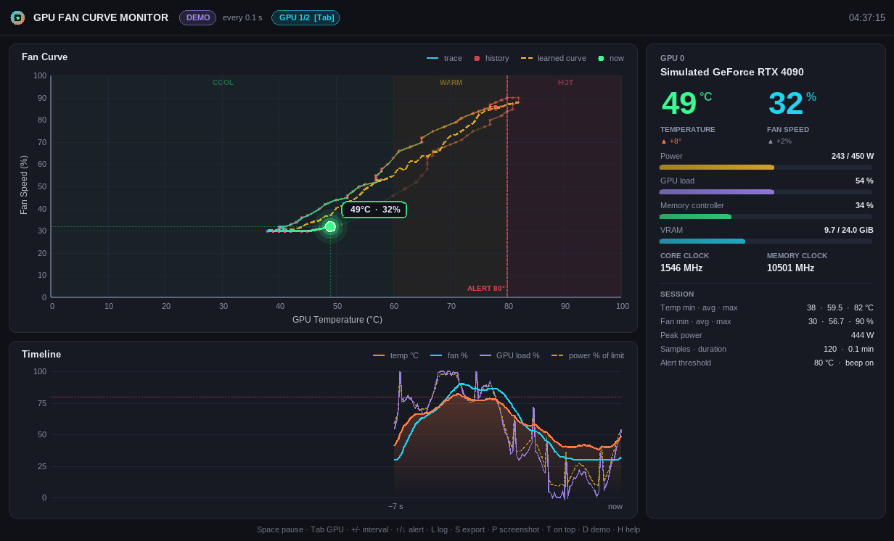

# GPU Fan Curve Monitor

A single, standalone Windows `.exe` that plots your NVIDIA GPU's **fan speed against temperature**
live, built by merging the five `GPUFANHEATDIAGRAMM*` prototypes (kept in `legacy/`) into one app with more features.



**Download:** [`dist/GPUFanCurveMonitor.exe`](dist/GPUFanCurveMonitor.exe). It's 64-bit and statically linked, so there's nothing to install.
It needs an NVIDIA driver, because it reads data through `nvidia-smi`. Without one, press **D** to try demo mode.

## Features

| Area | What you get |
|---|---|
| Fan curve plot | Trace of fan % vs °C whose colour follows temperature and fades with age, red history dots, a glowing "now" marker with crosshair and value bubble, cool/warm/hot zones, a **learned fan curve** (smoothed average fan % per °C) and a draggable-by-keyboard alert line |
| Timeline | Scrolling chart of temperature (with area fill), fan %, GPU load % and power % of the limit |
| Info panel | Large temperature and fan readouts with 30 s trend arrows, plus bars for power, GPU load, memory controller and VRAM. Also shows core and memory clocks and session min/avg/max, peak power, sample count and duration |
| Multi-GPU | Polls every GPU at once. **Tab** cycles between them and **0–9** jumps straight to one |
| Overheat alert | Adjustable threshold (↑/↓). When it trips you get a flashing red border, a header badge, a beep and a taskbar flash, with 3 °C hysteresis |
| Data | **S** exports the history to CSV, **L** logs continuously to CSV, **P** saves a PNG screenshot and **Ctrl+C** copies the window to the clipboard |
| Window | Dark theme with a dark title bar, anti-aliased GDI+ rendering, double buffering (no flicker), DPI awareness and resizing. **T** keeps it always on top, and the position and settings are saved to an `.ini` |
| Robustness | `nvidia-smi` runs hidden on a background thread, so there's no console flashing and the UI never freezes. It has a 5 s timeout, falls back to other install paths and drops to a minimal query on old drivers |

## Shortcuts

`Space` pause · `Tab`/`0-9` GPU · `+`/`-` interval (0.5–10 s) · `↑`/`↓` alert threshold · `B` beep ·
`L` log · `S` export · `P` screenshot · `Ctrl+C` copy · `T` on top · `C` clear · `D` demo · `H`/`F1` help.
Right-click opens a menu with all of these actions.

## Command line

```
GPUFanCurveMonitor.exe [--demo] [--interval ms] [--alert °C] [--log] [--topmost]
                       [--snapshot out.png [--samples N]]
```
`--snapshot` collects N samples (default 40), saves a PNG and exits. Use it for headless reports.

## Build

Linux, or MSYS2 with MinGW-w64:

```sh
sudo apt install g++-mingw-w64-x86-64   # Debian/Ubuntu
./build.sh                               # -> dist/GPUFanCurveMonitor.exe
```
`tools/gen_icon.py` regenerates `res/app.ico`.

## Fixes over the prototypes

- `WM_PAINT` drew into `ps.rcPaint` rather than the client rect, which broke the layout on partial repaints.
- `_popen` flashed a console window every 4 s and blocked the UI thread.
- Hard-coded string lengths in `TextOut` mixed ANSI and Unicode (`"Temperature (°C)", 18`), and one variant didn't compile.
- The GTK variant depended on the GTK runtime DLLs and mixed `HEIGHT` with the real window height.
